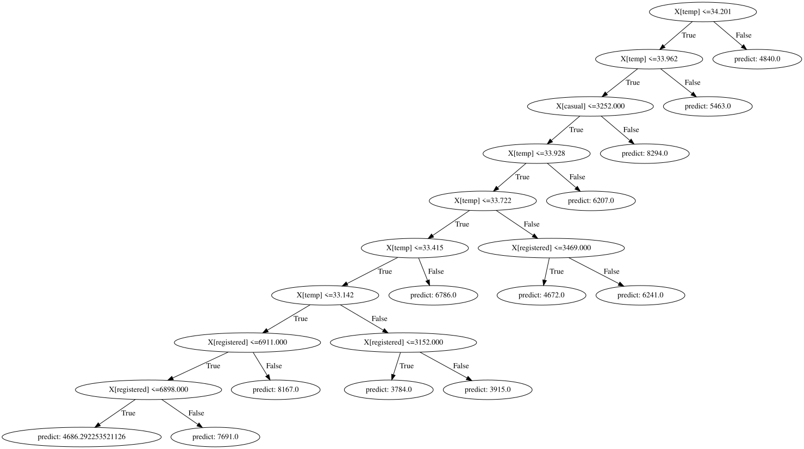

# Bike-sharing dataset with Random-forest

In this project I have applied Random forest from scratch in [Bike-sharing](https://www.kaggle.com/datasets/yasserh/bike-sharing-dataset) dataset in kaggle from it's notebook, trained it, stored the parameter and show the preview in streamlit app. This markdown is just the preview of the project and how I made this. I have given more details in my [notes](https://github.com/gitbhusalhubpramish/ml-notes/tree/main/0.005%20random-forest) about random forest.

This is what a decision tree looks like. random forest is the collection of trees like this. I have rendered 20 tree of depth 10 like this in [preview](https://bike-sharing-dataset-random-forest.streamlit.app/).

## Small intro to Random forest

Random forest is a supervised meachine learning algorithm where it runs many decision tree parallely in different data and take majyority votes or mean as output. This can be classification or regression. I've used regression model.

## Feature

This project was made by me to understand Random forest form scratch so it has random forest applied from scratch - trainied in kaggle notebooks and preview in streamlit app. But also:

- Random forest from scratch
- decision tree visulization
- GPU Parellized processing

## Tech-Stack

This project uses python liberies used for data science - Visulization, calculation and data manipulation. I've used:

- Numpy for calculation
- Streamlit for data visulizaion and preview
- cupy for GPU bahsed parellel processing
- Pandas for data manipulaion
- sk-learn for datasplit.
- Graphviz for graph visulization

## Work-flow

The workflow of the project is divided into 2 catogry:

### Kaggle side(training):

First I'd train the trees in data by building the algorithm from scratch. The flow looks like this:

- **Data fetch:** First data is initlized from the kaggle dataset to training environment.
- **Data Split:** Here the data is splited into 2(4) parts for training and testing for each with x and y.
- **Bootstrap:** We choose random data from teraining data so that we can train individual tree in different data/environment and each tree can learn one thing confidently. We do bootstarap n times where n is the number of tree.
- **Build tree:** A tree is build by calculating gini impurity or mse loss then finding a treshold in a feature which split data with higest purity and repeat untill the depth is max or data is fully pure or can't be split anymore.
- **Build Forest:** Here we train train multiple(n) trees simultaniously in bootstrap data.
- **running/testing:** A random forest run all trees simultaniously and takes mean or mode of the data according to it's type - here we take mean.
- **Export:** Since training model in streamlit server is expencive and requires gpu so we train model in kaggle environment and export model in `"forest.pkl"` and error in `"error.csv"`.

### Streamlit side(preview):

After training we show the preview of the model in streamlit app. the flow looks like:

- **data fetch:** we fetch data from kaggle and model parameters from the file for preview.
- **Visulization:** The app visulizes all the tree of model in tree graph using `graphviz`.

*Most of the training thing is done in kaggle side streamlit is just the previews.*

## So, what did I learn?

I had made this project to learn Random forest form scratch. Of cource I had learnt this:) but other stuff like:

- Random Forest
- Bootstrap
- MSE
- GPU Parellelization

## Some extra info...

I have been learning Meachine learning from scratch so I make notes and make atleast one project for each. I have writtern a jupiter notebook to plan and make this work then I make a python script file with the help of stremlit so that I can host and support hackclub. Most of the progress  of learning the algorithm is in my notebook(coding time only) while I struggle a lot to research about the algo and gpu acceration. I made this to learn so it has very less AI applied. Since, this project requires GPU so I trained and designed the algorithm in kaggle then exported the model. The project may seem like rendering project but it's really a AI model project.
